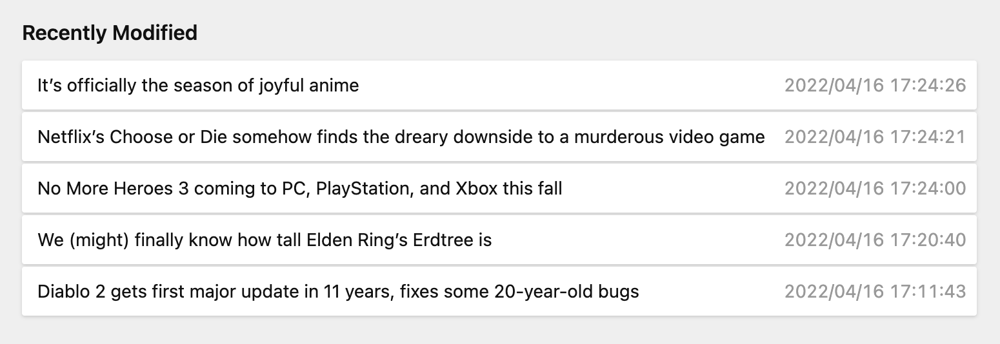
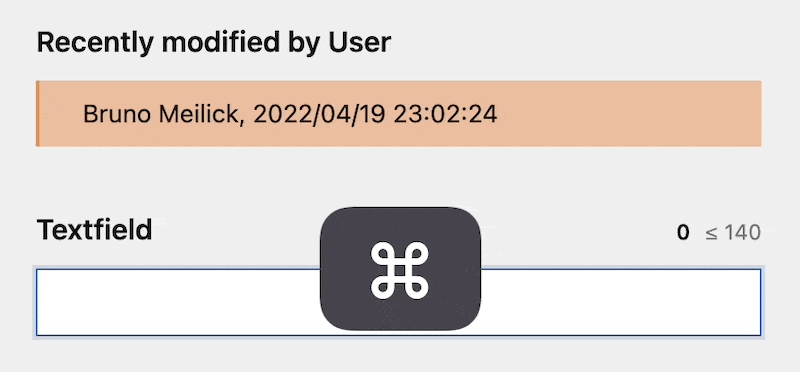

# Kirby Recently Modified

[](https://getkirby.com)

[](https://discordapp.com/users/bnomei)
[](https://www.buymeacoffee.com/bnomei)

Kirby 6 Panel fields that list pages edited by the current user and show who last edited a page or the site. Requires PHP 8.3 or newer supported by Kirby.

## Installation

- unzip [master.zip](https://github.com/bnomei/kirby3-recently-modified/archive/master.zip) as folder `site/plugins/kirby3-recently-modified` or
- `git submodule add https://github.com/bnomei/kirby3-recently-modified.git site/plugins/kirby3-recently-modified` or
- `composer require bnomei/kirby3-recently-modified`

## Screenshot

### Page list (Kirby 5 screenshot)


### Last editor (Kirby 5 screenshot)


## Usage

**Upgrading from Kirby 5:** Kirby 6 does not load custom sections. Move each `recentlymodified` **section** into `fields`, change its type to `recentlymodifiedlist`, and use `label` for its heading. Existing `recentlymodified` **fields** keep their type. Use plugin 5.x for Kirby 5.

Add a list to a site or page blueprint to show the current user's most recently edited pages, including drafts. The list contains pages only.

**site/blueprints/site.yml**
```yaml
fields:
  listPagesModifiedByUser:
    type: recentlymodifiedlist
    label: Your Recently Modified Pages
    # query
```

Add the modifier field to a site or page blueprint to show its last edit time and editor. Set `interval` in seconds to check for another editor's changes while the view is open. Without it the field still refreshes after saving or discarding changes.

**site/blueprints/pages/default.yml**
```yaml
fields:
  showWhichUserModifiedPage:
    type: recentlymodified
    label: Recently Modified By
    # interval: 60
```

> [!WARNING]
> This plugin has, by default, a 1 minute cache.

### Query for the page list

The default query shows the current user's edits. Supply a custom query that returns a pages collection to display a different list.

**Default Query**
```
site.index(true).sortBy('modified', 'desc').onlyModifiedByUser
```

> `onlyModifiedByUser` is a PagesMethod added by this plugin that filters the page collection to only those pages that were modified by the currently logged-in user. The plugin uses hooks to track what pages each user did edit.

**Example 1**
```yaml
fields:
  recentarticles:
    type: recentlymodifiedlist
    label: Recently Modified Articles
    query: site.find('articles').children.listed.sortBy('modified', 'desc')
```

**Example 2**
```yaml
fields:
  mycollection:
    type: recentlymodifiedlist
    label: My Collection
    query: kirby.collection('my-collection')
```
```php
return [
    'bnomei.recently-modified.limit' => 25, // default: 7
    'bnomei.recently-modified.info' => function ($page) {
        return $page->id();
    },
    // other options...
];
```

> TIP: You could use the `query` property, `info` and `limit` settings to show any list of pages you want, just like a simplified version of the page table plugin.

## Adjusting the Date formats

You can adjust the date formats based on the `date.handler` option. The default is `date`. The plugin `bnomei.recently-modified.format` is a callback that takes the `$datetime` string to format and ideally provides a format for all possible date handlers, returning the formatted string.

**site/config/config.php**
```php
<?php

return [
    // ... other values

    'date'  => [
        'handler' => 'date', // <!-- you could adjust the date handler here
    ],

    'bnomei.recently-modified.format' => function($datetime): string {
        $handler = kirby()->option('date.handler') ?? 'date';
        $formats = [
            'date' => 'Y/m/d H:i:s',          // <!-- the formats here
            'intl' => 'dd. MMMM yyyy, HH:mm', // <!-- and here
            'strftime' => '%Y/%m/%d %H:%M:%S' // <!-- or here
        ];
        $format = $formats[$handler] ?? $formats['date'];

        return Str::date($datetime, $format, $handler);
    },
];
```

## Known Limitations

- All `recentlymodifiedlist` fields share the `text`, `link` and `info` callbacks.
- The `limit` setting is always applied. If you want some of your instances to have a smaller number of items then call `limit` inside your custom query.

## Settings

| bnomei.recently-modified. | Default                | Description                             |            
|---------------------------|------------------------|-----------------------------------------|
| query                     | `...`                  | see above                               |
| link                      | `function($page){...}` | callback to return the link             |
| text                      | `function($page){...}` | callback to return the text             |
| info                      | `function($page){...}` | callback to return the info             |
| format                    | `fn($datetime){...}`   | custom date format callback             |
| hooks                     | `true`                 | use hooks to track users modified pages |
| limit                     | `7`                    | limit list and cache items              |
| expire                    | `1`                    | cache will expire n-minutes             |

## Test the Panel in an orb

From the repository root, run `.agents/setup`, `npm run build`, `amp orb services ensure`, then `tests/panel.sh`. Setup installs the locked Kirby release under `tests/`; to test a newer stable 6.x, run `composer update -d tests` first. The browser check starts with an empty plugin history in the disposable fixture, edits content as two users, and allows one minute for the default list cache to expire.

For manual testing, open the **Kirby 6 test Panel** portal and sign in with `robin@example.test` or `sam@example.test`. The generated test password is in `tests/.password` in the orb, outside the web root.

## Disclaimer

This plugin is provided "as is" with no guarantee. Use it at your own risk and always test it yourself before using it in a production environment. If you find any issues, please [create a new issue](https://github.com/bnomei/kirby3-recently-modified/issues/new).

## License

[MIT](https://opensource.org/licenses/MIT)

It is discouraged to use this plugin in any project that promotes racism, sexism, homophobia, animal abuse, violence or any other form of hate speech.
